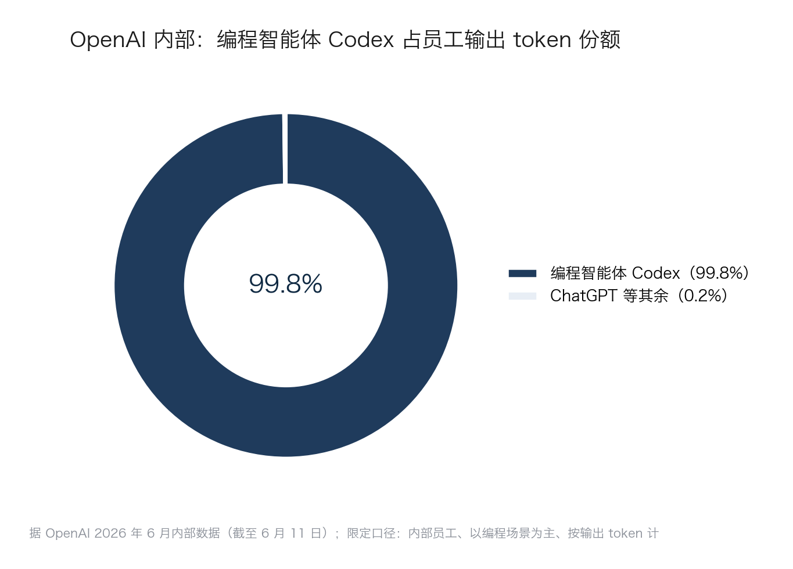
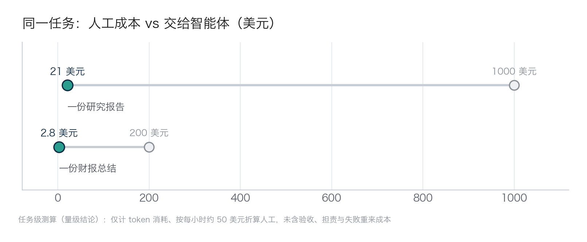

## 2.1 从助手到员工：智能体是什么

关于智能体，最常见的误会是把它当成“又一次工具升级”，即聊天机器人的加强版。这个理解会让企业错判整件事的量级。从时间上看，2024 年的大模型主要还在“动嘴”，在对话框里回答问题、生成文字；从 2025 年起，智能体开始“动手”，查数据、跑流程、操作系统，把一件事从头办成。从能力上看，分水岭可以概括为：**能回答的，只是助手；能交付的，才是员工。**

### 2.1.1 一条分界线：回答与交付

助手的职能是“咨询”。它替企业省下“查资料”的成本，相当于一个能听懂人话、给出连贯答案的搜索引擎。这很有价值，但价值有限：查完资料之后，理解、执行、核对、交付，仍然全部由人完成。

员工的职能是接受派任务，它替代的是“把这件事完成”所对应的那份人力。作为数字形态的员工，它还有三个人类员工不具备的特质。一是全天候：不休假、不下班，随叫随到。二是会学习：把每一次任务中沉淀的知识、话术、流程规则积累进企业知识库，越用越顺手。三是能分身：同一名“数字员工”可以同时复制出几十份并行干活，旺季扩编、淡季收缩，几乎没有招聘与解雇成本。

两者的差别可以用下表概括。

| 维度 | 助手（回答） | 员工（交付） |
|---|---|---|
| 交互方式 | 一问一答 | 接任务、交结果 |
| 替代的成本 | 查资料、起草的时间 | 完成整件事的人力 |
| 商业本质 | 更好用的搜索与写作工具 | 一种新型数字劳动力 |
| 验收方式 | 人自己判断答案好坏 | 像验收员工工作一样验收交付物 |

这条分界线对应的是算账口径：助手改善的是人的效率，员工改变的是任务的成本结构，后者才会触动企业的成本、组织与竞争壁垒。本书因此有一个贯穿全书的判断：对多数企业而言，这一轮 AI 落地价值兑现的主战场已经转向智能体。预测式 AI（如销量预测、信用评分）、内容生成等应用仍有各自的价值，也会继续创造回报，但能改变成本结构与组织结构的，是能把任务从头办成、可以按交付物验收的智能体。这并不等于“上 AI 就是上智能体”：只做前者，企业得到的多半是效率改善；要触及第七章讨论的那笔“劳动力级”的账，绕不开后者。

### 2.1.2 智能体的正式定义

本书对智能体给出如下定义：**智能体（AI Agent）是能够自主感知环境、规划步骤、调用工具并采取行动，以完成给定目标的 AI 系统。**

定义中有三个动词。“感知”指读懂任务要求和周边信息，如邮件、单据、系统里的数据；“规划”指把目标自主拆解成可执行的步骤，不必等人下达每一步指令；“行动”指操作工具与系统并交付结果。这三个动词对应[第一章“三级跳”](../01_essence/1.1_three_leaps.md)中“会干活”这最后一跳。

定义里最关键的词是“目标”。给助手的是问题，给智能体的是目标加验收标准，就像给员工派活：说清楚要什么结果、什么算合格，而不是口述每一个操作。智能体在技术上如何实现感知、规划与行动，由[第五章](../05_agent_tech/README.md)逐项拆解。

### 2.1.3 两个实证：头部已经翻篇

第一个实证来自造 AI 的公司自己。据 [OpenAI 2026 年 6 月发布的内部数据](https://openai.com/index/how-agents-are-transforming-work/)，截至 2026 年 6 月 11 日，其员工在 ChatGPT 与编程智能体 Codex 两类产品上产生的输出 token（词元，大模型计量和计费文本的基本单位）中，Codex 的占比约达 99.8%；包括法务、招聘等非技术部门在内，日常工作也已转向“派活给智能体”。下图直观呈现了这个近乎垄断的份额。

图 2-1 OpenAI 内部编程智能体占员工输出 token 份额示意

这个场景未必通用：一是样本为 OpenAI 内部员工，不代表普通企业；二是以编程场景为主；三是按“输出 token”口径统计，而非按任务数或工时。但它表明，连造 AI 的公司，内部工作方式都已从“问答”转向“派活”，趋势由此可见。

第二个实证是任务级的成本对比。一组任务级的成本测算（2025 年公开材料与作者接触的任务实测，无公开可核出处，仅取量级结论）显示：同样一份研究报告，人工成本约 1000 美元，交给智能体约 21 美元；一份财报总结，约 200 美元对约 2.8 美元。图 2-2 用哑铃图呈现成本从人工端到智能体端的落差。

图 2-2 任务级成本对比：人工与智能体示意

这项测算按每小时约 50 美元折算人工，只计算 token 消耗，没有包含验收、担责以及失败重来的代价；这些“人还得管”的成本，第七章会专门计算。即便把这些都加回去，两个量级的差距依然成立。成本曲线为何走到这一步，以及“同等能力降价与前沿能力涨价并存”的分化，见 [3.2 成本分化](../03_why_now/3.2_cost_curve.md)。

定义和实证共同表明：智能体是第一次可以按“劳动力”来理解和定价的软件。下一节讨论这名“员工”如何干活。
