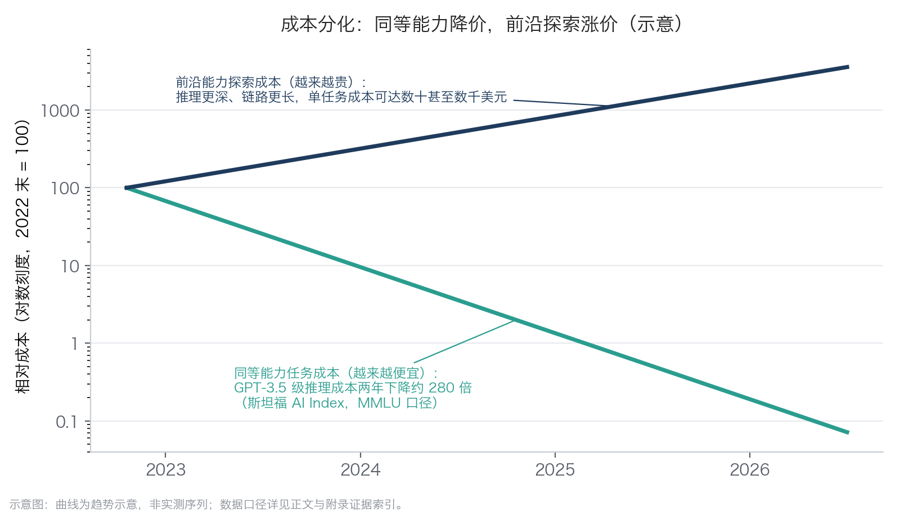

## 3.2 成本分化：降价与涨价并存

上一节把“成本下探”列为拐点的第二个条件，本节展开这笔账。评估 AI 成本时，许多管理者只看词元单价（词元 token 是模型计费的基本文本单位，释义见 [1.2](../01_essence/1.2_llm_base.md)、[4.1](../04_llm/4.1_next_token.md)）。词元单价逐年下调，降价公告也最常见诸新闻，但企业应当计算的是**完成同等难度的一件事所需的总成本**，正如评估电气化不能只看每度电价。一件真实任务往往包含多轮推理、多次工具调用与失败重试，词元消耗量与所选模型档次高度相关；任务之外还有数据准备、运营监控与风险成本（完整的算账框架见 [7.3](../07_value/7.3_cost_benefit.md)）。

[2.1](../02_agent/2.1_definition.md) 给出了任务级证据：行业研究报告、财报摘要这类任务交给智能体完成，产出成本比人工低约两个量级。这一结论来自特定任务的实测样本，且只计词元成本，未含验收与担责代价。2.1 还给出一项方向性证据：模型厂商内部的用量已从对话压倒性地转向智能体任务。两项证据共同表明，完成一件事的成本正在被重估。

同一时期存在两条方向相反的成本曲线。

### 3.2.1 下行曲线：同等能力越来越便宜

在固定的能力水平上，完成同等难度基准任务的价格，按特定基准的估算每年下降约 5 至 10 倍。[Epoch AI 对六个基准的测算](https://epoch.ai/data-insights/llm-inference-price-trends)给出的区间更宽：依基准与分数线不同，年降幅约 9 至 900 倍，中位数约 50 倍。各口径的数字差异很大，方向则高度一致。驱动因素至少有四个：算法与推理引擎的效率提升，开源模型的贴身竞争，“蒸馏”（用大模型生成的数据训练更小、更便宜的模型），以及推理芯片的持续迭代。

### 3.2.2 上行曲线：前沿能力越来越贵

前沿模型完成一件事的成本则不降反升，按特定基准的估算每年上涨约 3 至 18 倍。主因在推理深度而非单价：推理模型完成高难任务时会生成成千上万的内部推理词元，消耗量比普通问答高一到两个数量级。[ARC Prize 团队对 OpenAI o3 高算力档的测算](https://arcprize.org/blog/oai-o3-pub-breakthrough)是一个极端例子：在高难基准上，单题成本可达数千美元。另有研究者按运行前沿级模型的实际成本估算，涨幅约为每年两倍。不同方法的结果差异很大，说明两条曲线只是特定基准与估算方法下的趋势参照，不能当作定律外推；但“低端持续变便宜、高端持续变贵”的方向，在 2024—2026 年间被反复验证。

同等能力的价格坍塌与前沿能力的价格攀升同时发生。图 3-1 将两条曲线画在同一张对数坐标上。

图 3-1 成本分化示意（示意图：曲线为趋势走向，非实测序列；各项数字的口径与区间见正文）

### 3.2.3 笔者的观察框架：溢价词元与普通词元

对这两条曲线，笔者有一种更贴近采购直觉的读法。它来自一线产业观察，不是行业标准术语，也没有严格的测量支撑。企业买到的“智能”分为两种词元。**溢价词元**由最前沿的模型产出，智力密度高、单价昂贵，能完成其他模型完成不了的任务，如最难的研发问题、最深的分析、最含糊的需求，适合攻坚。**普通词元**由已经成熟的能力产出，单价低廉、供给充沛，适合大批量用于分类、抽取、应答、初稿等常规任务。

两者位于同一条传送带的两端：今天的溢价能力，不久就会降为普通能力。按笔者的观察，这个窗口约为三到六个月；这是经验估计而非测量值，不同任务领域的窗口长短差异很大。这里指同一能力从溢价档降到普通档的节奏（包括闭源厂商自家的轻量档与蒸馏产品），不同于开放权重模型追平闭源旗舰的时滞；后者见 [4.4](../04_llm/4.4_model_choice.md)，按任务约为数月到两年。窗口的存在把两条曲线联系起来：上行曲线上的买家，为提前几个月用上最强能力付费；下行曲线上的买家，等同一批能力降价后再大规模铺开。判断标准由此很简单：只有早几个月做成就能改变竞争位置的任务，才值得用溢价词元；其余绝大多数任务，用普通词元即可。这也为 [4.4](../04_llm/4.4_model_choice.md) 的“按任务分级配模型”策略提供了另一重依据：分级回应的是智能供给正在分层这一事实，并非只为节省成本。

### 3.2.4 管理含义：想清楚站在哪一头

低端越来越便宜、高端越来越贵，企业必须判断自己的每类任务站在哪一头。客服应答、单据处理、报告初稿、信息核对等绝大多数企业任务只要求“够用”：不需要最强模型，只需要稳定达到质量线的模型。这类任务位于下行曲线上，等价成本每年下降大半，去年评估为“算不过账”的场景，今年可能已经可行。因此，任何“上 AI 划不划算”的结论都有时效，这笔账应至少每年重算一次，并纳入预算节奏（见 [10.5](../10_strategy/10.5_pacing_reporting.md)）。

复杂研发、深度分析、事关重大的决策支持等少数高价值任务，值得为前沿能力支付溢价，但必须能回答“这一单是否值这个价”，并让模型档次与任务难度匹配，而不是全公司统一采购最贵的档位（模型选择的商业考量见 [4.4](../04_llm/4.4_model_choice.md)）。成本分化还意味着，把 AI 预算规划成一条均匀增长的直线，会在两个方向上同时出错：低端任务的单位预算应越花越少、覆盖面越铺越宽；高端任务的预算则要为“更贵但更强”留出弹性。智能的供给正在分层，企业要把每一层用在与之相称的问题上。
