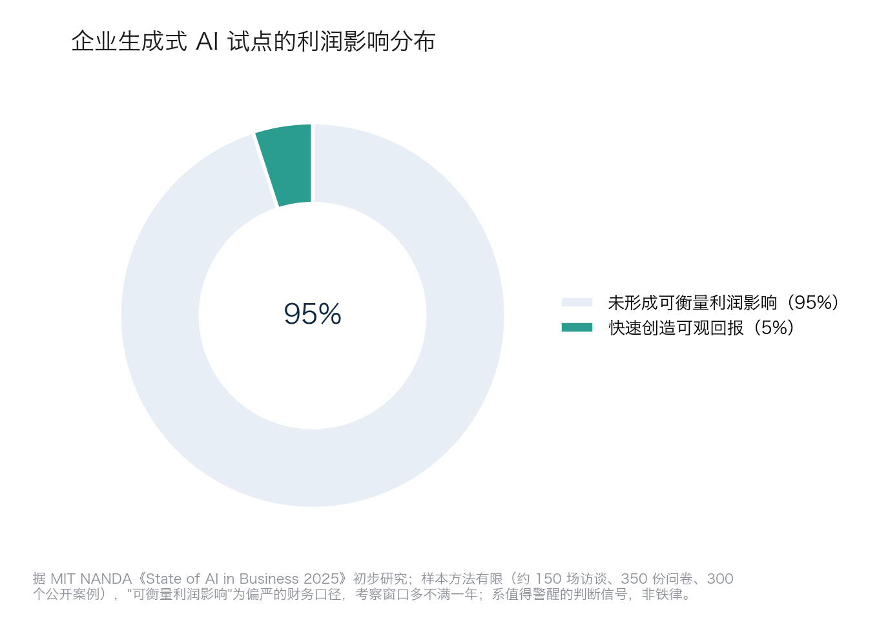
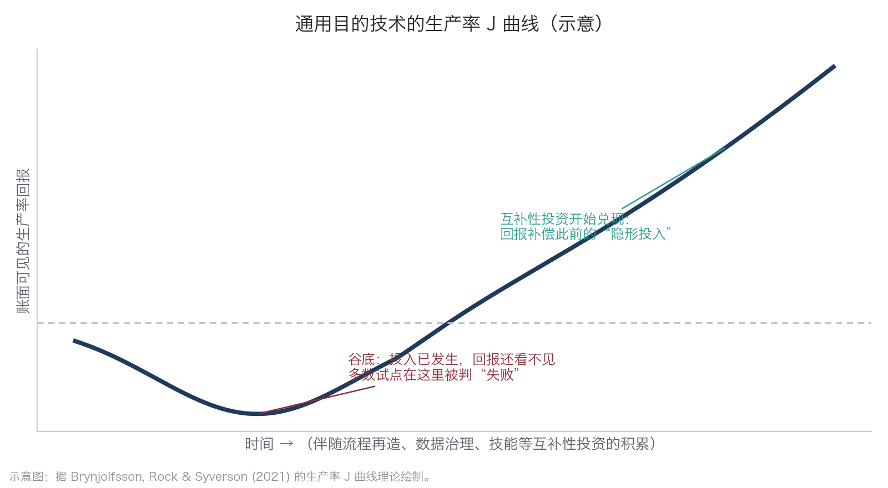

## 9.1 为什么多数试点没有回报

热潮之下有一个不容回避的事实：多数企业的 AI 试点至今没有换来可衡量的回报。本节先交代这组数字的口径与局限，再给出经济学解释：问题往往在于回报显现的方式，而不在技术本身。

### 9.1.1 一组刺眼的数字，及其口径与局限

2025 年夏，MIT NANDA 项目发布初步研究报告《The GenAI Divide: State of AI in Business 2025》，其中流传最广的结论是：约 95% 的企业生成式 AI 试点未形成可衡量的利润影响，只有约 5% 快速创造了可观回报（[报道参见 Fortune](https://fortune.com/2025/08/18/mit-report-95-percent-generative-ai-pilots-at-companies-failing-cfo/)）。同一研究的访谈样本还显示：与专业厂商合作的项目部署成功率约 67%，纯内部自建仅约 33%。

这组数字必须连同口径一起读，它至少有三点局限。第一，样本与方法有限：研究基于对 52 家机构的结构化访谈、153 位高管的问卷和 300 余个公开 AI 项目的分析，属初步研究，研究者也承认企业普遍不愿完整披露失败情况。第二，“可衡量的利润影响”是一个偏严的财务口径：大量分散在个人层面的效率改善（写作提速、检索省时）真实存在，只是难以在损益表上归因。第三，考察窗口很短：被统计的试点多数运行不满一年，而通用目的技术的回报本来就很少出现在第一年的账面上（见下文）。因此，95% 是一个值得警醒的信号，不是铁律：它证明“轻易就能做成”被严重高估，而非“AI 无用”。

一年之后，另一份口径完全不同的调查得出了方向一致的结果。据普华永道[《第 29 期全球 CEO 调研》](https://www.pwc.com/gx/en/news-room/press-releases/2026/pwc-2026-global-ceo-survey.html)（2026 年 1 月发布，调研窗口为 2025 年 9 月 30 日至 11 月 10 日，覆盖 95 个国家和地区的 4,454 位 CEO），过去 12 个月里 30% 的 CEO 说 AI 带来了增收，26% 说成本下降，而 **56% 说两样都没看到**；同时拿到增收与降本的只有 **12%**，约八分之一。两份研究恰好互补：MIT 考察试点项目的利润影响，普华永道调查 CEO 对整家公司财务结果的判断。一个是项目口径，一个是公司口径，样本、方法、时间窗都不同，结论却同向：**投入已经普遍发生，回报却高度集中在少数企业手里。**

普华永道对这少数企业的解释，与本章后面几节以及第十二章的治理主题高度重合：已经建立扎实 AI 底座的企业（报告点名的是负责任 AI 框架，以及能支撑全企业级集成的技术环境），报出实质财务回报的可能性约为其他企业的**三倍**（这是相关性表述，不宜直接读成因果）。区分这 12% 与 56% 的不是模型选型，是规模化之前是否先打好了基础。这正是[数据就绪](9.2_data_readiness.md)、[流程重构](9.3_workflow_rebuild.md)、[可信可控](9.5_trust_control.md)与[治理体系](../12_governance/12.3_governance_system.md)在本书中被放在如此靠前位置的原因。

下图中两块面积的悬殊，就是本章要回答的问题：为什么绝大多数试点停在没有账面回报的一侧。

图 9-1 企业生成式 AI 试点的利润影响分布示意

同期还有一个常被并列引用的数字：Gartner 于 2025 年 6 月[发布预测](https://www.gartner.com/en/newsroom/press-releases/2025-06-25-gartner-predicts-over-40-percent-of-agentic-ai-projects-will-be-canceled-by-end-of-2027)，到 2027 年底，超过 40% 的智能体项目将因成本升级、商业价值不清或风险控制不足而被取消。这是预测而非已发生的统计，如何理解它见本节末尾。

### 9.1.2 败因清单：几乎都不在技术

MIT 研究把失败的核心归因于“学习鸿沟”（learning gap）：通用工具嵌不进企业的具体工作流，不能从反馈中持续改进，组织也没有为此做出相应改造。用经营语言表述，反复出现的败因有三项：

- **数据没就绪**：接入 AI 后才发现关键数据散在纸面、微信和互不相通的表格里（9.2 节展开）；
- **流程没打通**：给旧流程配了一个助手，节拍、审批、考核原封不动，个体提效被组织摩擦抵消（9.3 节展开）；
- **目标没定义**：立项时没有可量化的验收标准，运行半年仍说不清成败（9.4 节给出定目标的方法）。

模型能力本身很少是首要败因。这与第八章案例的观察一致：同样的模型，有企业做出了写进财报的回报，也有企业停在演示环节。

### 9.1.3 生产率 J 曲线：回报去哪儿了

经济学对这一现象有成熟的解释。经济学家 Erik Brynjolfsson 与合作者提出的“生产率 J 曲线”（[Brynjolfsson, Rock & Syverson, 2021](https://www.aeaweb.org/articles?id=10.1257/mac.20180386)）指出：通用目的技术落地初期，企业必须先完成大量互补性无形投资：流程再造、数据治理、技能培训、组织调整。这些投入在会计上大多计为当期费用，不形成账面资产，于是报表呈现“投入很多、产出不显”，测得的生产率甚至先降后升，轨迹呈 J 形。[第 1.2 节](../01_essence/1.2_llm_base.md)讲过电气化的先例：工厂用电动机替换蒸汽机后二十余年生产率才爆发，因为回报要等到围绕电力重新设计厂房与流程之后才释放。

下图是这条曲线的走势：左半段先下探，互补投资已经发生，账面回报尚未出现，多数试点正是在谷底附近被判“失败”；跨过谷底后，前期的“隐形投入”开始兑现，回报进入加速释放的右半段。

图 9-2 通用目的技术的生产率 J 曲线示意

这个判断不只来自经济学家。[第 3.1 节](../03_why_now/3.1_conditions.md)引述的 OpenAI“能力悬垂”（capability overhang，又译“能力过剩”）报告在这里有第二重含义。在第 3.1 节，它印证的是“能力已跨过可用门槛”；从 J 曲线的视角看，它印证的是另一半：模型已经能做到的与企业实际用出来的之间存在巨大鸿沟，这道鸿沟要靠使用侧的互补投资填补。连模型供给方都承认“能力已经够用，却没被用出来”，说明瓶颈在流程、数据与队伍，而不在技术。能力悬垂正是 J 曲线左半段的技术侧成因。

J 曲线给管理者两个推论。其一，95% 中相当一部分试点并非“做错了”，而是尚处曲线左半段：互补投资没有完成，回报自然不可见。其二，J 曲线不能当作遮羞布，分水岭在于企业是否在做互补投资。在补数据、改流程、练队伍的企业，是“回报暂时看不见”；只买了工具、其余一切照旧的企业，是“回报永远不会来”。区分这两者，也是 9.6 节判断一个试点该继续还是该止损的核心依据。

### 9.1.4 炒作周期里的 40%

Gartner 40% 的预测应当放在技术成熟度曲线中理解。Gartner 自己的技术成熟度曲线（Hype Cycle，又译“炒作周期”：新技术通常经历期望膨胀高峰、幻灭低谷、稳步爬升的舆论周期）在 [2025 年 8 月的评估](https://www.gartner.com/en/newsroom/press-releases/2025-08-05-gartner-hype-cycle-identifies-top-ai-innovations-in-2025)中，将 AI 智能体置于“期望膨胀高峰”，而生成式 AI 正滑向“幻灭低谷”。笔者认为，按这条曲线的规律，高峰期立项的项目大批出清是历代新技术都经历过的常见现象，正如互联网泡沫的破裂并未否定互联网。因此，40% 的取消预测提醒的是“高峰期入场需要纪律”，而非“方向错了”：被出清的多半是没有数据、流程与目标支撑的项目，这三项正是接下来几节的主题。
